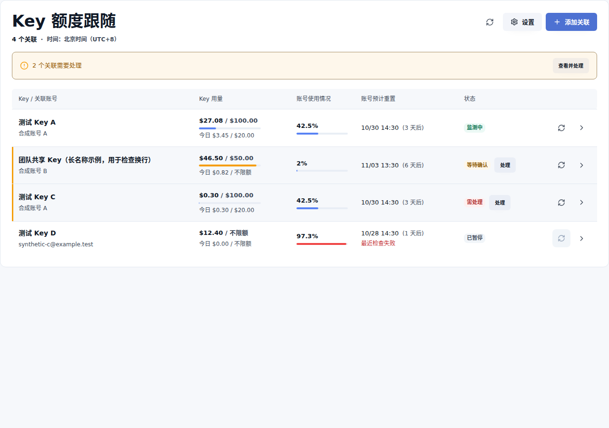
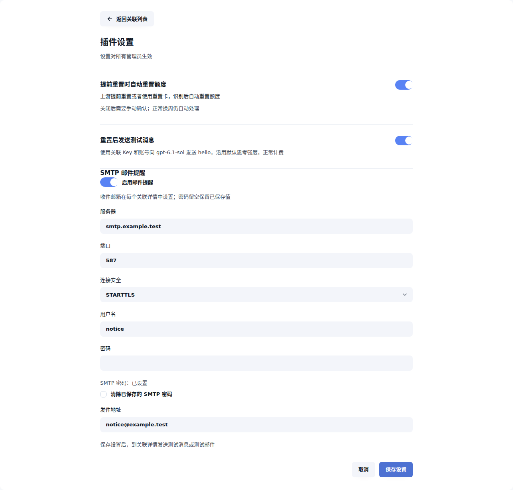

# Key 周额度跟随账号重置

> **来源说明**：本仓库是基于 [Ming-321/CPR-key-reset-follow](https://github.com/Ming-321/CPR-key-reset-follow) 的二次修改版本，由 [haohex](https://github.com/haohex) 维护，非原作者发布。原作者实现了周额度跟随与安全清零的核心逻辑，版权与 Apache-2.0 许可归原作者所有；本仓库的修改同样以 Apache-2.0 发布。
>
> 主要修改：日、周用量同步清零；适配 CPR 3.34；重置后发送测试消息与 SMTP 邮件提醒；手动发送测试；页面与邮件时间统一为北京时间 UTC+8。插件 ID 自 0.2.0 起改为 `haohex.key-reset-follow`，与原作者的 `ming321.key-reset-follow` 是两个独立插件。问题请在本仓库反馈，不要提交到原作者仓库。

[Codex Proxy RS](https://github.com/zyycn/codex-proxy-rs) 的独立插件，适合固定使用某个 Codex 账号的 Key。关联后，插件会跟随账号的周额度窗口，同时重置 Key 的今日用量和本周用量，减少管理员逐个手动重置的维护负担。

一个账号可以关联多个 Key，各 Key 独立计费。正常换周自动处理；上游提前重置或使用重置卡后，也可自动跟随，或由管理员手动确认。

## 安装

要求 **官方 Codex Proxy RS ≥3.34.0 且 <3.35.0 · Linux x86_64 / ARM64**。SDK 与打包工具固定 v3.34.0（插件 RPC 7）；本版宿主安装与升级测试由使用者完成。CPR 3.29.x 请使用 v0.1.4 等先前发布的兼容版本，3.30–3.33 无对应发行包。

以下为首次安装步骤：

1. 打开宿主的 **插件管理 → 安装插件 → GitHub**。
2. 仓库填写 `haohex/CPR-key-reset-follow`。版本标签留空即可查询最新正式版，无需勾选“允许查询预发行版”。
3. 点击“下一步”，选择与宿主架构对应的 `.tar.gz` 附件（x86_64 或 aarch64/ARM64），按提示完成安装并启用。
4. 打开插件页面，点击“添加关联”，选择现有 Key 和对应的 Codex 账号。

首次关联只记录当前周期，不清零。Key 应已通过宿主的分组与路由设置使用该账号；插件不会替你调整路由。

安装包和同名 `.sha256` 校验文件见 [Releases](https://github.com/haohex/CPR-key-reset-follow/releases)。也可以下载后在“上传包”中安装。

**从 `ming321.key-reset-follow` 迁移：** 0.2.0 起插件 ID 变为 `haohex.key-reset-follow`，宿主视为新插件，不能在旧插件上直接更新，旧插件的私有数据也不会迁移。按以下顺序手动迁移：

1. 在旧插件中记下每个关联的 Key 与账号、各 Key 的收件邮箱，以及设置页的开关和 SMTP 参数。
2. **先停用旧插件**。两个插件同时启用并关联同一个 Key 时，换周会各自清零一次。
3. 按上方步骤从 GitHub 安装并启用本插件，在设置中填写 SMTP 与开关，再逐个添加关联并保存收件邮箱。
4. 新关联只记录当前周期，不补做清零；旧插件的事件与发送历史不会出现在新插件中。
5. 确认新插件运行正常后，再按需卸载旧插件。卸载会删除旧插件的私有数据，保留停用状态可作为对照。

已安装本插件后，在插件详情点击“检查更新”即可查询最新正式版；预发行版需要固定标签，不会被检查更新发现。页面与邮件时间统一为北京时间 UTC+8。

## 使用

列表展示 Key 的本周用量、账号使用百分比、预计重置时间和当前状态。右上角“刷新”更新列表，行内“立即检查”会主动检查账号额度。

在“设置”中可调整：

- **提前重置时自动重置额度**：默认开启。上游提前重置或者使用重置卡，识别后自动重置额度；关闭后需要手动确认，正常换周仍自动处理。
- **重置后发送测试消息**：默认关闭。确认 Key 清零成功后，用该 Key 与关联账号向 `gpt-6.1-sol` 发送 `hello`，不指定思考强度，正常计费；模型不可用或权限不足不会改用其他模型
- **SMTP 邮件提醒**：默认关闭。填写服务器、端口、TLS 或 STARTTLS、认证信息和发件地址；在关联详情为每个 Key 保存收件邮箱。密码留空保留已有值，也可明确清除，保存后不回显

重置后的测试和邮件分批执行，通常在后续维护轮次完成；邮件包含 Key 名称、重置时间（固定北京时间 UTC+8）与测试结果，测试失败或未知仍可提醒。详情展示发送状态；未知或失败任务只允许管理员确认可能重复后手动重试，不会重新清零。暂停关联或关闭对应发送开关会停止发送；恢复开关后继续处理排队任务；关闭测试但继续邮件时，该次待测试记为跳过，不在恢复测试后补发。修改收件邮箱只影响之后的重置

每个关联最多保留 32 条发送记录，全插件最多 128 条；已完成历史会清理，未知与待发送记录不自动删除。积压达到限制时，仍完成清零，本次测试与邮件不排队并记录事件，需管理员处理积压

在设置中保存 SMTP 参数，再到关联详情点击“发送测试消息”或“发送测试邮件”，独立确认后立即发送，无需等待周限重置，也不会清零或更新周期基线。手动测试允许自动开关关闭或关联暂停；消息仍使用关联 Key 与账号，正常计费；邮件使用已保存的 SMTP 和该关联邮箱，主题明确为 SMTP测试。收件邮箱草稿须先保存

详情分别保留最近一次手动消息与邮件的持久结果。未确认成功时显示“可能已发送”，刷新与维护不会重发；再次确认测试可能重复计费或投递。页面或请求报错后先刷新查看结果，再决定是否重发

需要处理时，点击对应行的“处理”。暂停、恢复和删除关联在详情中；恢复时重新记录当前周期，不补做暂停期间错过的重置。

## 使用前了解

- 账号重置后，上游可能要等到下一次使用才返回固定的新周期。插件通常每 5 分钟检查一次；首次确认换周或提前重置时自动清零一次，之后等待新周期结束时间固定，不因未使用期间预计时间持续后移而重复清零或重复记录事件。
- CPR 仍独立计算 Key 自身的周用量重置时间，可能比账号窗口早约 24 小时清零。插件不会让这两个时间完全对齐；Key 的这项时间可在详情查看。
- 如果清零结果无法确认，插件会停止自动重试。默认可保留现有用量并跳过；选择“再清零一次”可能清掉期间新增的消费，操作前需要明确确认。
- 从 v0.1.1 升级时，原有关联、设置与待处理状态保留。旧状态无法确认当前周期是否已处理时，先等待有效样本建立稳定基线，不补做可能已完成的清零；这期间无法证实的一次重置可能被跳过。
- 每次清零同时重置 Key 的日用量和周用量，宿主在同一事务中完成；不会只清其中一项。
- 停用或卸载可停止后续动作，已完成的清零无法撤销。

## 更多

[深色主题](docs/screenshots/dark.png) · [窄屏](docs/screenshots/narrow.png) · [添加关联](docs/screenshots/add.png) · [待确认](docs/screenshots/early.png) · [结果未知](docs/screenshots/unknown.png) · [今日用量详情](docs/screenshots/daily-detail.png)

原有截图来自官方宿主中的实际插件页面，使用合成数据；[设置](docs/screenshots/settings.png)与[今日用量详情](docs/screenshots/daily-detail.png)已替换为当前构建的合成桥接预览。通知功能的[设置](docs/screenshots/notifications-settings.png)、[详情](docs/screenshots/notifications-detail.png)、[深色](docs/screenshots/notifications-dark.png)与[窄屏](docs/screenshots/notifications-narrow.png)截图来自当前构建的合成数据预览，使用公开 UI 的主题变量；不代表真实宿主、模型或 SMTP 联调通过。
手动测试的[结果详情](docs/screenshots/manual-test-result.png)和[发送确认](docs/screenshots/manual-test-confirm.png)同样来自合成桥接预览，不代表真实外部发送验收

开发、联调和发布见 [贡献指南](CONTRIBUTING.md)，周期判定与恢复规则见 [设计文档](docs/design.md)。

许可证：[Apache-2.0](LICENSE)
